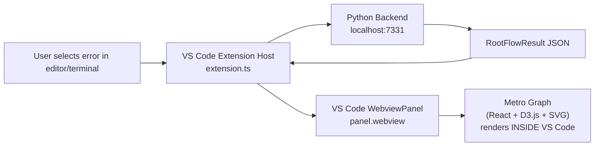
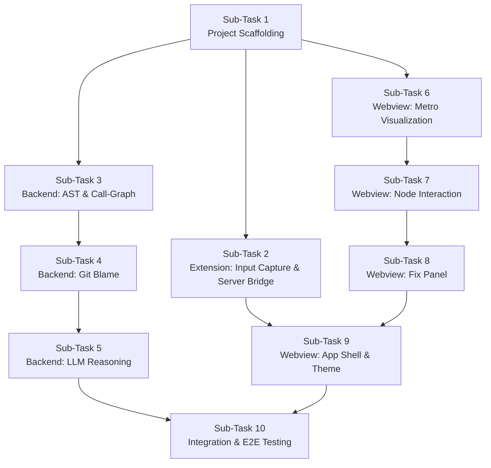
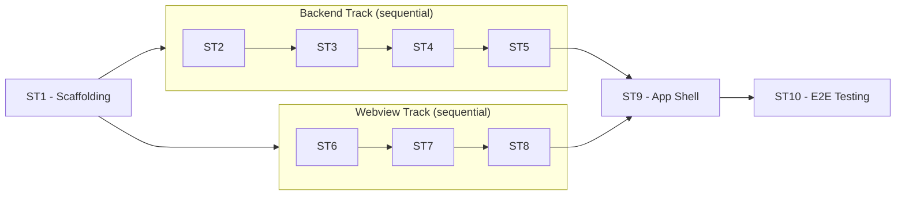

# @rootflow-plan.md tell me in this plan  the weview for bug isualisation is vs code and it will show in vs code only rather than a seperate browser

---

**Status:** active  **Date:** 2026-09-25

---

### 👤 User

@rootflow-plan.md tell me in this plan  the weview for bug isualisation is vs code and it will show in vs code only rather than a seperate browser

---

### 🤖 Assistant

> 🔧 called: read_file


> 🔧 **read_file** — rootflow-plan.md

### 🤖 Assistant

Yes, the plan already specifies that the visualization lives **inside VS Code** — not in a separate browser. Here's the evidence directly from the document:

---

### Where the plan confirms: VS Code Webview (not a browser)

**Top-Level Overview (line 9):**
> *"A VS Code extension (TypeScript) captures the user's selected error/test failure, sends it to the Python server, and **renders the JSON result in a Webview panel**."*

**Stack (line 14):**
> *"Webview UI: TypeScript, React, D3.js, SVG"*
> — This is a VS Code Webview, not a standalone browser app.

**Sub-Task 6 — Webview: Metro-Style Visualization (line 268):**
> *"`MetroGraph` React component receives a `RootFlowResult` and renders an SVG metro map"*
> — Rendered inside the VS Code Webview panel.

**Sub-Task 9 — App Shell (line 369):**
> *"Webview HTML is generated by the extension using `getNonce()` CSP pattern; all scripts are loaded from `panel.webview.asWebviewUri`."*
> — [`panel.webview.asWebviewUri`](rootflow-plan.md:369) is a VS Code-specific API that converts local resource paths into Webview-safe URIs. This is **only used in VS Code Webviews**, not in browsers.

**Sub-Task 9, Todo #6 (line 376):**
> *"Update `extension.ts` to generate the **Webview HTML**..."*

---

### Architecture diagram



---

### Summary

The entire visualization stack — React, D3.js, SVG metro graph, `NodeDetailPanel`, `FixPanel`, `App.tsx` — is rendered inside a **VS Code `WebviewPanel`**. It never opens a browser. The use of VS Code-specific APIs like `panel.webview.asWebviewUri`, `getNonce()` CSP, and `acquireVsCodeApi().postMessage` (which only works inside a VS Code Webview) all confirm this is exclusively an in-editor experience.

---

### 👤 User

there are 10 sub task can i run 10 task parallelly all at onc

---

### 🤖 Assistant

No, you cannot run all 10 sub-tasks in parallel. The plan has **explicit sequential dependencies**. Here's the breakdown:

---

### Dependency Chain



---

### Why full parallelism is blocked

| Reason | Details |
|---|---|
| **ST1 must go first** | Every other sub-task depends on the scaffolded folder structure, `package.json`, `schema.ts`, `schema.py`, and the stub server created in Sub-Task 1 |
| **Backend is a strict chain** | ST3 → ST4 → ST5: Git blame (ST4) needs the propagation path from AST (ST3); LLM reasoning (ST5) reuses the tree-sitter AST already built in ST3 |
| **Webview is a strict chain** | ST6 → ST7 → ST8 → ST9: each component builds on the previous one (`NodeDetailPanel` uses `MetroGraph`, `FixPanel` sits alongside both, `App.tsx` composes all three) |
| **ST10 must go last** | The plan explicitly states *"All prior sub-tasks must be complete before this sub-task"* (line 397) |

---

### What CAN run in parallel

Once **Sub-Task 1 is complete**, you can split into **two parallel tracks**:



**Maximum parallelism = 2 tracks running simultaneously after ST1**, not 10 tasks at once. The soonest ST10 can start is after both tracks converge at ST9.

---

### 👤 User

in sub task why should i manuallly set up the watsonx evironment or bob will automatically acces the imb cloud account

---

### 🤖 Assistant

> 🔧 called: read_file, search_ibm_docs

Let me read the current state of the plan first, then check Bob's documentation on watsonx access.

> 🔧 **read_file** — rootflow-plan.md

> 🔧 **search_ibm_docs** — bob

### 🤖 Assistant

**Bob does NOT automatically access your IBM Cloud/watsonx.ai account for your RootFlow project.** These are two completely separate things. Here's the clear distinction:

---

### What Bob is vs. what your project needs

| | **Bob (the AI coding assistant)** | **Your RootFlow project (Sub-Task 5)** |
|---|---|---|
| **What it is** | IBM's AI IDE assistant — the tool you're using right now | A Python backend you are *building* that calls watsonx.ai |
| **Who calls watsonx** | Bob itself uses IBM's infrastructure internally | Your `WatsonxReasoner` class calls watsonx.ai from *your code* |
| **Credentials** | Managed by IBM, tied to your Bob subscription | You must supply your own `WATSONX_API_KEY` + `WATSONX_PROJECT_ID` |
| **Automatic?** | Yes — Bob's own LLM access is automatic | ❌ No — your Python app needs its own API key |

---

### Why you must set up credentials manually in Sub-Task 5

Your [`WatsonxReasoner`](rootflow-plan.md:247) class in `backend/analyzer/watsonx_reasoner.py` will call the **`ibm-watsonx-ai` Python SDK** directly:

```python
from ibm_watsonx_ai.foundation_models import ModelInference

model = ModelInference(
    model_id=os.environ["WATSONX_MODEL_ID"],
    credentials={"apikey": os.environ["WATSONX_API_KEY"], "url": os.environ["WATSONX_URL"]},
    project_id=os.environ["WATSONX_PROJECT_ID"]
)
```

This is a **direct API call from your Python server to IBM Cloud** — completely independent of Bob. It requires:

1. **`WATSONX_API_KEY`** — an IBM Cloud IAM API key (generated from [cloud.ibm.com](https://cloud.ibm.com))
2. **`WATSONX_PROJECT_ID`** — your watsonx.ai project ID (from the watsonx.ai console)
3. **`WATSONX_URL`** — the regional endpoint (e.g. `https://us-south.ml.cloud.ibm.com`)
4. **`WATSONX_MODEL_ID`** — the Granite model ID (e.g. `ibm/granite-13b-instruct-v2`)

The plan already accounts for this at [line 253](rootflow-plan.md:253):
> *"Add `WATSONX_API_KEY`, `WATSONX_PROJECT_ID`, `WATSONX_URL`, `WATSONX_MODEL_ID` to a `.env` file (loaded with `python-dotenv`)"*

---

### In short

> Bob helps you **write** the code for Sub-Task 5. But the watsonx.ai API calls your code makes at **runtime** go directly from your Python server to IBM Cloud — that requires your own IBM Cloud account and credentials, set up manually in a `.env` file.

---

### 👤 User

which ibm model are you planning to use

---

### 🤖 Assistant

> 🔧 called: grep


> 🔧 **grep** — model|granite|WATSONX_MODEL

### 🤖 Assistant

> 🔧 called: read_file


> 🔧 **read_file** — backend/.env.example

### 🤖 Assistant

The model is already set in your [`.env.example`](backend/.env.example:7):

```
WATSONX_MODEL_ID=ibm-granite/granite-4.0-h-small
```

That's **IBM Granite 4.0 Turbo Small** (`granite-4.0-h-small`). The plan refers to it generically as "Granite" throughout (e.g. [line 8](rootflow-plan.md:8) and [line 221](rootflow-plan.md:221)), and the actual specific model ID was pinned in the `.env.example` file.

---

### Why Granite 4.0 Small is a reasonable choice for this use case

| Property | Detail |
|---|---|
| **Model** | `ibm-granite/granite-4.0-h-small` |
| **Purpose** | Code reasoning, root-cause explanation, fix generation |
| **Why Small?** | Lower latency, lower token cost — fits well for a local developer tool where response speed matters |
| **Suitable?** | Granite models are specifically trained on code and enterprise tasks, making them well-suited for the debugging/fix-suggestion task in Sub-Task 5 |

---

### One thing to flag ⚠️

Your [`.env.example`](backend/.env.example:4) has what looks like a **real API key** on line 4:

```
WATSONX_API_KEY=Zt0G8gvk6ljLmajibsYD8yXgdgU5S6dr_t9cdvpIsZY_
```

If that is a real IBM Cloud IAM key, you should **rotate it immediately** on [cloud.ibm.com](https://cloud.ibm.com) and replace it with a placeholder like `your-api-key-here`. The plan itself says at line 253: *"Never commit `.env` to version control"* — but `.env.example` is typically committed, so it must never contain real secrets.