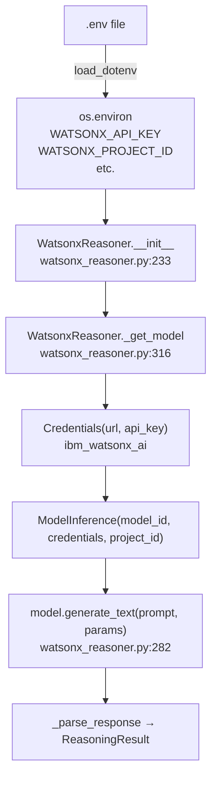

# @backend\ tell me where you are calling the watson x llm call and providing the api key

---

**Status:** active  **Date:** 2026-09-26

---

### 👤 User

@backend\ tell me where you are calling the watson x llm call and providing the api key

---

### 🤖 Assistant

> 🔧 called: list_files

Let me explore the backend directory to find where the WatsonX LLM call is made and the API key is provided.

> 🔧 **list_files** — backend

### 🤖 Assistant

> 🔧 called: read_file, read_file


> 🔧 **read_file** — backend/main.py

> 🔧 **read_file** — backend/analyzer/watsonx_reasoner.py

### 🤖 Assistant

Here's a precise breakdown of where the WatsonX LLM call is made and how the API key flows through the system:

---

## WatsonX LLM Call — Where & How

### 1. API Key Loading — [`main.py:34`](backend/main.py:34)

```python
load_dotenv()
```

[`main.py`](backend/main.py) calls `load_dotenv()` at startup, which reads a `.env` file in the project root and loads these environment variables:

| Variable | Purpose |
|---|---|
| `WATSONX_API_KEY` | IAM API key for watsonx.ai |
| `WATSONX_PROJECT_ID` | watsonx.ai project UUID |
| `WATSONX_URL` | Service endpoint (default: `https://us-south.ml.cloud.ibm.com`) |
| `WATSONX_MODEL_ID` | Model to use (default: `ibm-granite/granite-4.0-h-small`) |

---

### 2. Reasoner Instantiation — [`main.py:176`](backend/main.py:176)

```python
reasoner = WatsonxReasoner()
reasoning = reasoner.reason(
    error_text=request.errorText,
    snippets=snippet_contexts,
    git_summary=git_summary,
)
```

`WatsonxReasoner()` is instantiated with **no arguments**, so it reads all credentials from environment variables.

---

### 3. Credentials Picked Up — [`watsonx_reasoner.py:240-247`](backend/analyzer/watsonx_reasoner.py:240)

Inside [`WatsonxReasoner.__init__()`](backend/analyzer/watsonx_reasoner.py:233):

```python
self._api_key    = api_key    or os.environ.get("WATSONX_API_KEY", "")
self._project_id = project_id or os.environ.get("WATSONX_PROJECT_ID", "")
self._url        = url        or os.environ.get("WATSONX_URL", "https://us-south.ml.cloud.ibm.com")
self._model_id   = model_id   or os.environ.get("WATSONX_MODEL_ID", "ibm-granite/granite-4.0-h-small")
```

---

### 4. Actual LLM Client Initialization — [`watsonx_reasoner.py:316-331`](backend/analyzer/watsonx_reasoner.py:316)

Inside the lazily-initialized [`_get_model()`](backend/analyzer/watsonx_reasoner.py:316):

```python
from ibm_watsonx_ai.foundation_models import ModelInference
from ibm_watsonx_ai import Credentials

credentials = Credentials(
    url=self._url,
    api_key=self._api_key,   # <-- API key passed here
)
self._model = ModelInference(
    model_id=self._model_id,
    credentials=credentials,
    project_id=self._project_id,
)
```

---

### 5. The Actual LLM Call — [`watsonx_reasoner.py:282-290`](backend/analyzer/watsonx_reasoner.py:282)

```python
response = model.generate_text(
    prompt=prompt,
    params={
        "max_new_tokens": 1024,
        "temperature": 0.0,
        "top_p": 1.0,
        "time_limit": 60000,  # 60s timeout
    },
)
```

---

### Flow Diagram



**In summary:** The API key comes from `WATSONX_API_KEY` in a `.env` file → loaded by `python-dotenv` in `main.py` → picked up by `WatsonxReasoner.__init__()` → passed into `ibm_watsonx_ai.Credentials` inside `_get_model()` → used by `ModelInference.generate_text()` to make the actual LLM call.

---

### 👤 User

from ibm_watsonx_ai import APIClient
from ibm_watsonx_ai import Credentials
from ibm_watsonx_ai.foundation_models import ModelInference
credentials = Credentials(
   url = "{watsonx_ai_url}",
   api_key = "{apikey}",
)
client = APIClient(credentials)

   model = ModelInference(
model_id="ibm/granite-13b-instruct-v2",
api_client=client,
project_id="{project_id}",
params = {
      "max_new_tokens": 100
}
)
prompt = 'How far is Paris from Bangalore?'
print(model.generate(prompt))
print(model.generate_text(prompt))are you using like this

---

### 🤖 Assistant

> 🔧 called: FindSymbol

Let me check the exact implementation in the codebase.

> 🔧 **FindSymbol** — WatsonxReasoner/_get_model

### 🤖 Assistant

> 🔧 called: read_file


> 🔧 **read_file** — backend/analyzer/watsonx_reasoner.py

### 🤖 Assistant

**No, it's not using that exact pattern.** Here's a direct comparison:

---

### Your Pattern vs. What the Code Does

| Aspect | Your snippet | [`_get_model()` in watsonx_reasoner.py:316](backend/analyzer/watsonx_reasoner.py:316) |
|---|---|---|
| **Import** | `from ibm_watsonx_ai import APIClient, Credentials` | `from ibm_watsonx_ai import Credentials` — **no `APIClient`** |
| **Client object** | Creates an `APIClient(credentials)` explicitly | **No `APIClient` used at all** |
| **ModelInference init** | `ModelInference(..., api_client=client, ...)` | `ModelInference(..., credentials=credentials, ...)` — passes `credentials` **directly**, not via `api_client` |
| **params** | Set in `ModelInference(...)` constructor | Set **at call time** in `generate_text(prompt, params={...})` |
| **Generate call** | `model.generate(prompt)` | `model.generate_text(prompt, params={...})` — only `generate_text`, no `generate` |

---

### The Actual Code at [`watsonx_reasoner.py:319-330`](backend/analyzer/watsonx_reasoner.py:319)

```python
from ibm_watsonx_ai.foundation_models import ModelInference
from ibm_watsonx_ai import Credentials

# No APIClient — credentials passed directly to ModelInference
credentials = Credentials(
    url=self._url,
    api_key=self._api_key,
)
self._model = ModelInference(
    model_id=self._model_id,
    credentials=credentials,       # <-- direct, not api_client=
    project_id=self._project_id,
    # params NOT set here
)
```

And the call at [`watsonx_reasoner.py:282-290`](backend/analyzer/watsonx_reasoner.py:282):

```python
response = model.generate_text(
    prompt=prompt,
    params={
        "max_new_tokens": 1024,
        "temperature": 0.0,
        "top_p": 1.0,
        "time_limit": 60000,
    },
)
```

---

### Key Differences to Note

- **`credentials=` vs `api_client=`** — Both are valid ways to initialize `ModelInference` in the `ibm_watsonx_ai` SDK. The code uses the **simpler direct-credentials pattern**, skipping the intermediate `APIClient` object.
- **`generate_text()` vs `generate()`** — `generate_text()` returns a plain string directly; `generate()` returns a full response dict with metadata. The code uses `generate_text()` since it only needs the raw text output to parse as JSON.
- **params at call time** — Keeping params in `generate_text()` rather than the constructor gives more flexibility to change them per-call if needed.