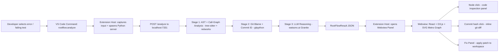
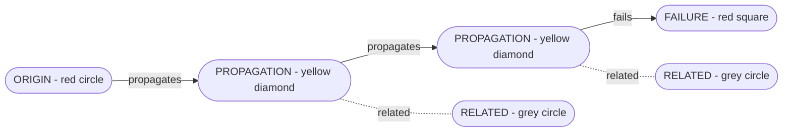

# We are building a VS Code extension that The system should identify the probable root cause, trace how the bug propagated through the codebase to the point where the failure occurred, suggest a fix, provide a confidence score, and identify the specific Git commit that likely introduced the bug.

The agent should produce structured JSON containing the information required to represent the analysis and construct a visual model inside VS Code.

The main concept of RootFlow is an interactive 2D metro-style visualization of the bug's propagation through the codebase.

The visualization should represent the origin of the bug, its propagation path, the important files/functions involved, the failure point, and related parts of the repository. The main affected files on the causal path should be distinguishable from other related or unaffected parts of the codebase.

Users should be able to interact with the visualization to understand the relationship between the files involved, inspect the relevant code and exact location of the issue, understand the reasoning/evidence behind the root-cause identification, and explore the Git history associated with the bug.

RootFlow should also provide a suggested fix and allow the developer to apply and verify the fix.called RootFlow  The key idea is to help a developer understand:

where the bug originated → how it propagated through the codebase → where it failed → which Git change introduced it → how it can be fixed.give me a implmentation plan

---

**Status:** active  **Date:** 2026-09-25

---

### 👤 User

We are building a VS Code extension that The system should identify the probable root cause, trace how the bug propagated through the codebase to the point where the failure occurred, suggest a fix, provide a confidence score, and identify the specific Git commit that likely introduced the bug.

The agent should produce structured JSON containing the information required to represent the analysis and construct a visual model inside VS Code.

The main concept of RootFlow is an interactive 2D metro-style visualization of the bug's propagation through the codebase.

The visualization should represent the origin of the bug, its propagation path, the important files/functions involved, the failure point, and related parts of the repository. The main affected files on the causal path should be distinguishable from other related or unaffected parts of the codebase.

Users should be able to interact with the visualization to understand the relationship between the files involved, inspect the relevant code and exact location of the issue, understand the reasoning/evidence behind the root-cause identification, and explore the Git history associated with the bug.

RootFlow should also provide a suggested fix and allow the developer to apply and verify the fix.called RootFlow  The key idea is to help a developer understand:

where the bug originated → how it propagated through the codebase → where it failed → which Git change introduced it → how it can be fixed.give me a implmentation plan

---

### 🤖 Assistant

> 🔧 called: use_skill


> 🔧 **use_skill** — create-plan

### 🤖 Assistant

> 🔧 called: list_files


> 🔧 **list_files** — .

### 🤖 Assistant

> 🔧 called: ask_followup_question

This is a greenfield project. Before I write the plan, I need to clarify a few key decisions to scope this correctly.

### 🤖 Assistant

What languages/runtimes should RootFlow support for bug analysis? This affects the static analysis, call-graph tracing, and AST parsing strategies throughout the plan.

> 🔧 **ask_followup_question** — What languages/runtimes should RootFlow support for bug analysis? This affects the static analysis, call-graph tracing, and AST parsing strategies throughout the plan.

### 🤖 Assistant

> 🔧 called: ask_followup_question


### 🤖 Assistant

What is the source of the bug report that RootFlow will analyze? How does a developer trigger the analysis?

> 🔧 **ask_followup_question** — What is the source of the bug report that RootFlow will analyze? How does a developer trigger the analysis?

### 🤖 Assistant

> 🔧 called: ask_followup_question


> 🔧 **ask_followup_question** — done

### 🤖 Assistant

> 🔧 called: ask_followup_question


### 🤖 Assistant

How should the Python agent perform root cause analysis — what analysis strategies should it use?

> 🔧 **ask_followup_question** — How should the Python agent perform root cause analysis — what analysis strategies should it use?

### 🤖 Assistant

> 🔧 called: ask_followup_question


### 🤖 Assistant

How should the VS Code extension communicate with the Python agent backend?

> 🔧 **ask_followup_question** — How should the VS Code extension communicate with the Python agent backend?

### 🤖 Assistant

> 🔧 called: ask_followup_question


### 🤖 Assistant

Which LLM provider should the Python agent use for its reasoning layer?

> 🔧 **ask_followup_question** — Which LLM provider should the Python agent use for its reasoning layer?

### 🤖 Assistant

> 🔧 called: ask_followup_question


### 🤖 Assistant

For the metro-style visualization, what level of interactivity is required for the MVP?

> 🔧 **ask_followup_question** — For the metro-style visualization, what level of interactivity is required for the MVP?

### 🤖 Assistant

> 🔧 called: update_todo_list

Now I have all the context needed to write a thorough plan. Let me compose it.

> 🔧 **update_todo_list** — [-] Write RootFlow implementation plan file

### 🤖 Assistant

> 🔧 called: write_file


> 🔧 **write_file** — rootflow-plan.md

### 🤖 Assistant

> 🔧 called: update_todo_list


> 🔧 **update_todo_list** — [x] Write RootFlow implementation plan file

### 🤖 Assistant

The plan has been written to [`rootflow-plan.md`](rootflow-plan.md). Here's the full picture before you review it:

---

## Architecture Overview



---

## Metro Graph Visual Model



---

## 10 Sub-Tasks at a Glance

| # | Sub-Task | Key Output |
|---|---|---|
| 1 | Project Scaffolding | `extension/`, `backend/`, `shared/`, build configs |
| 2 | Extension Input Capture & Server Bridge | Command handler, `AnalysisClient`, server lifecycle |
| 3 | AST & Call-Graph Analysis | `tree-sitter` parse, `networkx` call graph, propagation trace |
| 4 | Git Blame & Commit Identification | `gitpython` blame, `introducedByCommit` block |
| 5 | LLM Reasoning via watsonx.ai Granite | Explanation, confidence score, fix suggestion |
| 6 | Metro-Style Visualization | D3 force-layout SVG, metro line + station nodes |
| 7 | Node Interaction & Code Inspection | Click-to-inspect panel, file/diff navigation |
| 8 | Fix Panel & One-Click Apply | Diff view, `WorkspaceEdit` patch application |
| 9 | App Shell, Layout & Theme | Full Webview composition, CSP, VS Code theme vars |
| 10 | E2E Testing & Documentation | Fixture project, pytest E2E, `vsce package`, README |

---

**Three questions to validate the plan before we move to implementation:**

1. **Scope** — The plan focuses entirely on analyzing the **developer's own workspace** codebase. Should RootFlow also support analyzing **dependencies / `node_modules` / `site-packages`**, or is workspace-only correct for the MVP?

2. **LLM prompt strategy** — Stage 5 sends code snippets + call graph summaries to Granite. Should the prompt include **full file contents** (better context, higher token cost) or **function-level snippets only** (faster, cheaper)? The plan currently uses function-level snippets.

3. **Sub-task ordering** — Sub-tasks 3 → 4 → 5 are sequenced so each stage enriches the JSON before handing off. Is that the right ordering, or would you prefer the LLM stage to run first to identify the likely origin before the static analysis confirms it?

---

### 👤 User

1. scope - The plan is to focusing  entirely on analyzing the developer's own workspace codebase2. llm prompt statergy - Keep function-level snippets. make sure each snippet includes the full function body plus signature/decorators and immediate imports it depends on, not just the bare line that errored3. sub - task ordering - Keep 3 → 4 → 5

---

### 🤖 Assistant

> 🔧 called: read_file

The scope and design decisions are confirmed. Let me update the plan to reflect the refined LLM prompt strategy and then we can move to implementation.

> 🔧 **read_file** — rootflow-plan.md

### 🤖 Assistant

> 🔧 called: read_file


> 🔧 **read_file** — rootflow-plan.md

### 🤖 Assistant

> 🔧 called: apply_diff

Now I have full context. I'll apply precise targeted edits to Sub-Task 5 to capture the confirmed snippet strategy, and add an explicit **Decisions** section to the plan header.

> 🔧 **apply_diff** — rootflow-plan.md

### 🤖 Assistant

The plan is updated. Here's a precise summary of every change made and what the final plan now mandates:

---

## What Changed in [`rootflow-plan.md`](rootflow-plan.md)

### 1 — Confirmed Design Decisions block (new, top of plan)
Three locked-in decisions are now recorded permanently at the top of the plan so every sub-task implementer reads them first:

| Decision | What it means |
|---|---|
| **Scope** | Workspace only. `node_modules` / `site-packages` are never parsed, walked, or blamed. |
| **Snippet strategy** | Function-level: full signature + decorators + full body + only the imports the function directly uses. No bare lines, no full files. |
| **Pipeline order** | 3 → 4 → 5 (AST/call-graph → Git blame → LLM). LLM always receives fully assembled structural context. |

---

### 2 — Sub-Task 5 is now significantly more precise

**Added: `SnippetExtractor` as an explicit new class** (`backend/analyzer/snippet_extractor.py`) — it reuses the `tree-sitter` AST from Stage 3 (no second disk read), scans function body identifiers against the file's import table to resolve only the imports the function actually uses, and captures decorator nodes.

**Added: Snippet Extraction Rule** — a numbered, unambiguous contract in the plan:
1. Imports the function directly references
2. Decorators applied to the function
3. Full signature (including type annotations)
4. Full body, untruncated

**Added: Explicit prompt structure** — the three sections of the Granite prompt are now specified:
```
System: role + JSON-only instruction + response schema
User:   [error text] → [git blame summary] → [per-node labelled snippet blocks]
```

**Added: 2 new test items** — `test_snippet_extractor.py` (asserting import/decorator/signature/body extraction) and the existing `test_watsonx_reasoner.py` now explicitly mocks `ModelInference`.

---

## The plan is ready. To begin implementation, switch to Agent mode and start with Sub-Task 1.

```mermaid
graph LR
  ST1[Sub-Task 1: Scaffolding] --> ST2[Sub-Task 2: Extension Bridge]
  ST2 --> ST3[Sub-Task 3: AST + Call-Graph]
  ST3 --> ST4[Sub-Task 4: Git Blame]
  ST4 --> ST5[Sub-Task 5: LLM Reasoning - Granite]
  ST5 --> ST6[Sub-Task 6: Metro Visualization]
  ST6 --> ST7[Sub-Task 7: Node Interaction]
  ST7 --> ST8[Sub-Task 8: Fix Panel]
  ST8 --> ST9[Sub-Task 9: App Shell]
  ST9 --> ST10[Sub-Task 10: E2E + Docs]
```



When you're ready, switch to **Agent mode** and say **"implement Sub-Task 1"** — I'll scaffold the full project structure before touching any logic.

### 🤖 Assistant

Previous conversation summary:

## Goal
Build a VS Code extension called **RootFlow** that automatically identifies the probable root cause of a bug, traces its propagation through the codebase, identifies the introducing Git commit, suggests a fix, and renders all of this as an interactive 2D metro-style visualization inside a VS Code Webview panel.

The key developer journey: **where the bug originated → how it propagated → where it failed → which Git commit introduced it → how to fix it.**

---

## Instructions

### Stack (locked in)
- **Extension host:** TypeScript, VS Code Extension API
- **Webview UI:** TypeScript + React + D3.js + SVG
- **Backend:** Python, FastAPI, IBM watsonx.ai SDK (Granite model), GitPython, `tree-sitter`
- **Communication:** HTTP REST on `localhost:7331`

### Trigger mechanism
Developer selects a failing test or error message in the VS Code terminal/output panel → triggers via command palette (`RootFlow: Analyze Bug`) or right-click context menu.

### Confirmed Design Decisions (locked, do not revisit)
1. **Analysis scope:** Workspace codebase only. `node_modules`, `site-packages`, and external dependencies are excluded

